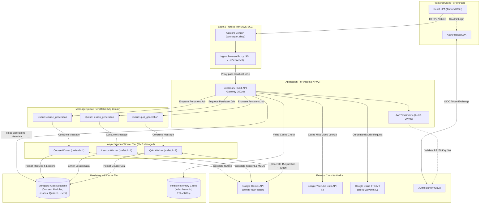
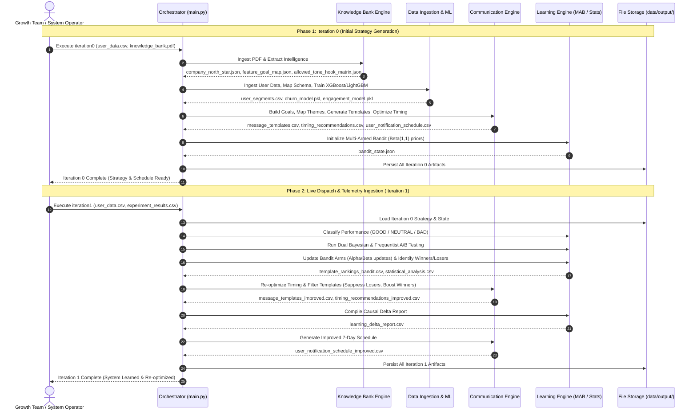

# Text To Course features for users:

This Website is for everyone, because no matter, what your age, profession, gender, etc., everyone keeps learning something throughout their lifetime. And for learning in most efficient way today, we have AI. So just type the topic name in search bar and it will generate a really good comprehensive course, that starts from basics, heads to complex and advanced concepts, as you go forward.

Why to use this instead of chatgpt or Gemini directly?

Because, chatgpt does give information, but it does not give it in a structured way that you can follow for learning a chapter. Structured learning always benefit more than just getting random information and typing prompts again and again to learn pre-requisites.

A video for Website:

UI is designed in a very simple way that you can easily figure out everything yourself!

# Text To Course - AI Course Generation Platform

TextToCourse is a full stack web app with backend system that converts user prompts into fully structured courses using asynchronous job processing, worker pools, and fault-tolerant message queues.

The platform is designed to be scalable, resilient, and production-ready. Instead of handling expensive AI generation inside HTTP requests, it offloads work to background workers through RabbitMQ, allowing the API to remain fast and reliable under load. The API publishes jobs to RabbitMQ. Workers consume these jobs and perform AI-based course generation asynchronously.

Results are written to MongoDB and served to users when ready. This architecture enables horizontal scaling, fault isolation, and non-blocking API performance.

## Tech Stack

**Client:** React CRA

**Server:** Node, Express

**Database:** MongoDB

**Message Queue:** RabbitMQ

**Authentication:** Auth0

**Deployment:** pm2 on AWS EC2 Linux Machine

**CI/CD:** Github Actions

## Some important API Reference

#### Get all course

```http
GET /api/courses
```

| Parameter | Type     | Description               |
| :-------- | :------- | :------------------------ |
| `userId`  | `string` | **Required**. Your userId |

#### Generate Course

```http
POST /api/courses/generateCourse
```

| Body    | Type     | Description              |
| :------ | :------- | :----------------------- |
| `Topic` | `string` | **Required**. Topic name |

#### Generate Lesson

```http
POST /api/lessons/:lessonId/generate
```

| Parameter  | Type     | Description                        |
| :--------- | :------- | :--------------------------------- |
| `lessonId` | `string` | **Required**. LessonId is required |

#### Generate Quiz

```http
POST /api/courses/:courseId/quiz
```

| Parameter  | Type     | Description                        |
| :--------- | :------- | :--------------------------------- |
| `courseId` | `string` | **Required**. courseId is required |

These are some of the important APIs, many other APIs are used, which are not mentioned here.

## Deployment

The application is deployed using a production-grade cloud setup.

The frontend is hosted on Vercel and is accessible via the website link provided in the GitHub repository’s About section.

```bash
https://text-to-course-scalable.vercel.app/dashboard
```

The backend is deployed on AWS EC2 and exposed through a custom domain. Nginx is used as a reverse proxy to route incoming traffic to the Node.js API, and HTTPS is enabled using a Let’s Encrypt SSL certificate.

A GitHub Actions CI/CD pipeline is configured to automatically deploy the backend on every push to the main branch:

1. GitHub Actions runs a basic CI step
2. Code is pulled into EC2 over SSH
3. Dependencies are installed
4. PM2 restarts the API and worker processes

This provides continuous delivery with no manual server access required.

The backend domain for project is

```bash
https://coursegene.shop
```

## Run Locally

To deploy this project on local machine,

Clone the project

```bash
git clone https://github.com/i-m-kartik-01/TextToCourseScalable-Final
```

For Backend, install dependencies

```bash
cd server
npm install
```

Now, start index.js API, and workers

```bash
npm start
node worker/courseWorker.js
node worker/lessonWorker.js
node worker/quizWorker.js
```

For Frontend, install dependencies and start Frontend API

```bash
cd client
npm install
npm start
```

### Environment Variables

Both the backend and the frontend read their configuration from a `.env` file. Create one in each directory before starting the app.

`server/.env`

| Variable | Description |
| :------- | :---------- |
| `PORT` | Port the Express API listens on |
| `NODE_ENV` | `development` locally, `production` on EC2 |
| `MONGO_URI` | MongoDB connection string |
| `RABBITMQ_URL` | RabbitMQ connection string used by the API and workers |
| `REDIS_URL` | Redis connection string used for caching YouTube video links |
| `GEMINI_API_KEY` | Google Gemini API key used for course, lesson and quiz generation |
| `YOUTUBE_API_KEY` | YouTube Data API key used to attach videos to lessons |
| `AUTH0_DOMAIN` | Auth0 tenant domain used to validate JWTs |
| `AUTH0_AUDIENCE` | Auth0 API identifier used to validate JWTs |
| `FRONTEND_URL` | Origin allowed by CORS |

`client/.env`

| Variable | Description |
| :------- | :---------- |
| `REACT_APP_API_BASE_URL` | Base URL of the backend API |
| `REACT_APP_AUTH0_DOMAIN` | Auth0 tenant domain |
| `REACT_APP_AUTH0_CLIENT_ID` | Auth0 application client ID |
| `REACT_APP_AUTH0_AUDIENCE` | Auth0 API identifier, must match `AUTH0_AUDIENCE` on the server |

Note that the API and each worker are separate long-running processes, so run the four backend commands above in four separate terminals.

## Design Decisions

### RabbitMQ instead of synchronous requests and workers separated:

RabbitMQ is used to decouple the API from long-running AI generation tasks, preventing request timeouts and allowing independent scaling of workers.

### Uses of Redis and pm2:

Redis is used for caching links of youtube videos, further redis caching will be included for other DB fetches too, PM2 is used to run, monitor, and automatically restart Node.js API and worker processes in the EC2 Linux environment.

### Fault Tolerance:

The system is designed to remain reliable in the presence of failures. All background jobs are persisted in RabbitMQ, ensuring that no work is lost if a worker or server crashes. Workers can be stopped, restarted, or scaled without affecting job integrity because messages remain in the queue until successfully processed.

The API layer is stateless, allowing multiple instances to be run or restarted at any time without losing user or job state. Since heavy processing is handled asynchronously, the system follows an eventual consistency model, where results are delivered once background workers complete their tasks, rather than blocking client requests.

### Security:

The platform uses JWT-based authentication via Auth0 to securely identify and authorize users. All API requests to protected endpoints require a valid access token, ensuring only authenticated users can access their data.

The backend is exposed over HTTPS, with SSL certificates issued by Let’s Encrypt and automatically managed using Certbot. Nginx acts as a reverse proxy in front of the Node.js application, terminating SSL and forwarding secure traffic to the API server. This ensures all data transmitted between clients and the backend is encrypted and protected from interception.

### Further scaling

1. Workers can be scaled horizontally. If demand increases, we can run more workers for the same task, e.g. 3 courseWorkers, 5 lessonWorkers, 2 quizWorkers.
2. RabbitMQ allows load leveling and backpressure spike handling. Even when 10k users click "Generate Course", their requests can be queued, preventing the API from being overwhelmed by the generation workload.
3. EC2 can be replaced with ECS/Kubernetes in later stages, when load increases further.

### Further improvements in general

1. Retry logic
2. Dead-letter queues
3. Circuit breakers
4. Observability using Prometheus and Grafana
5. Worker autoscaling
6. Can incorporate a low priority queue for lesson generation and quiz generation, immediately after course generation. This is not possible now because per-day requests for Gemini API calls are limited and stop working after exceeding that limit.

### Why AWS EC2 instead of Render for backend?

Because Render costs much more for background workers, and EC2 gives a full machine, so it doesn't matter how many workers we incorporate.

### Why NGINX and Let's Encrypt?

AWS EC2 only gives an IP address, so we have to buy a domain and include SSL ourselves. Vercel requires HTTPS, hence SSL certificates are mandatory. NGINX is used for reverse proxying and Let's Encrypt provides the SSL certificate.


## 7. High-Level Architecture

The system follows an **Asynchronous Decoupled Hexagonal Architecture**. The user-facing HTTP tier is decoupled from expensive generative workloads via an AMQP message broker.



---


## 4. Core User Journey

The operational journey represents an automated lifecycle loop executed in two sequential phases:


